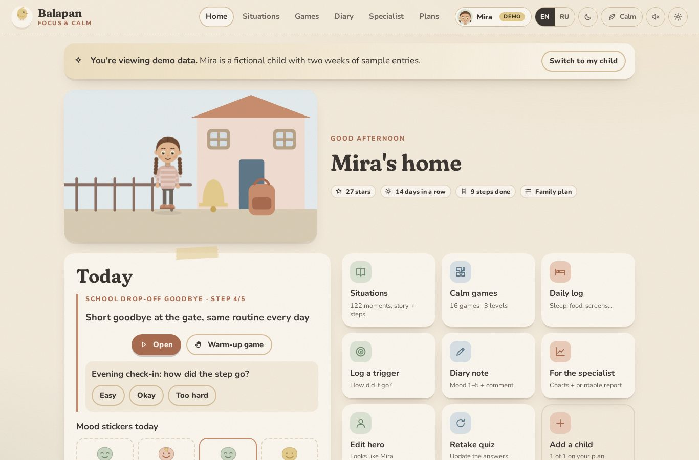
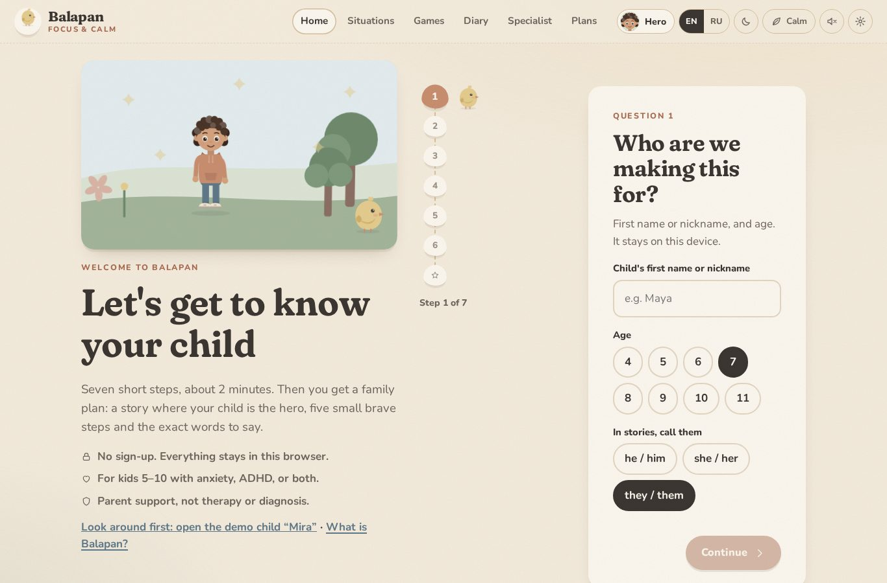
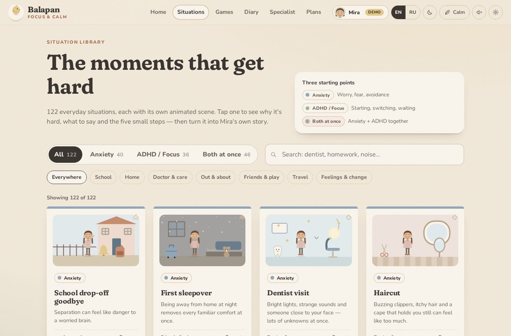
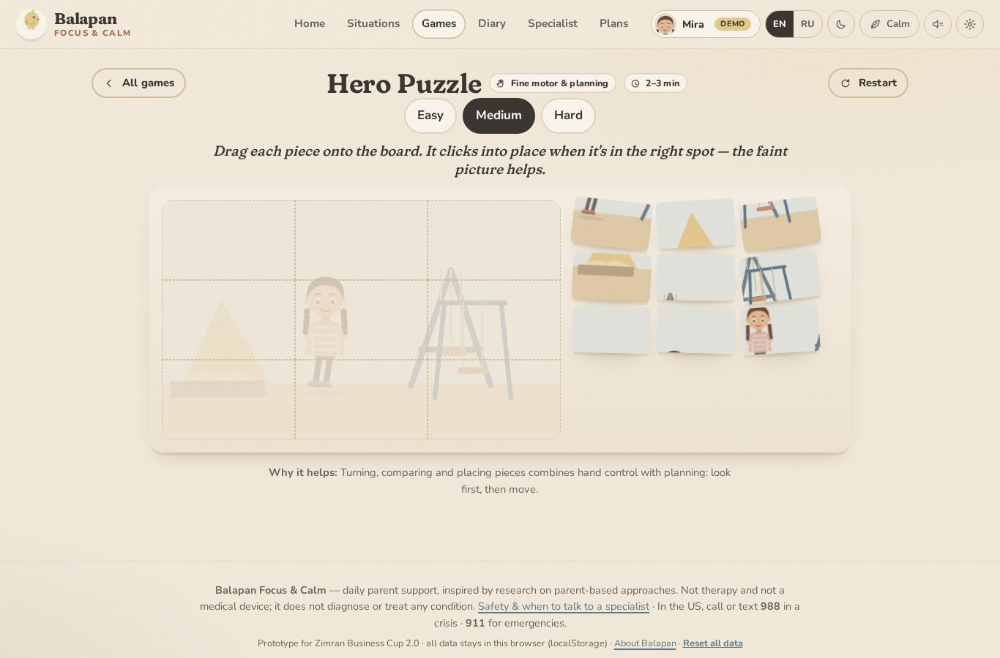
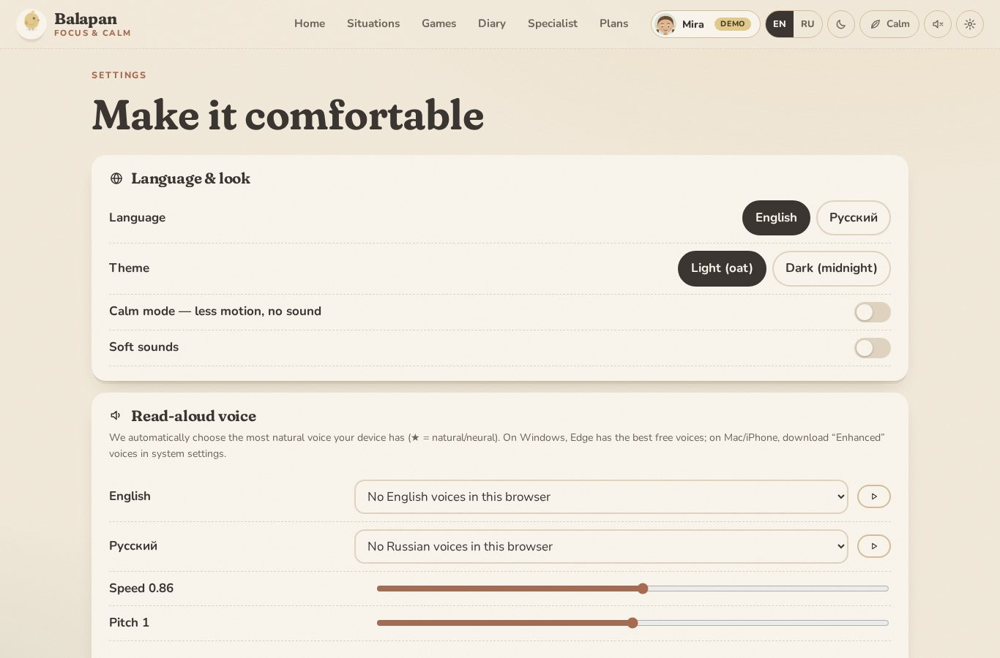
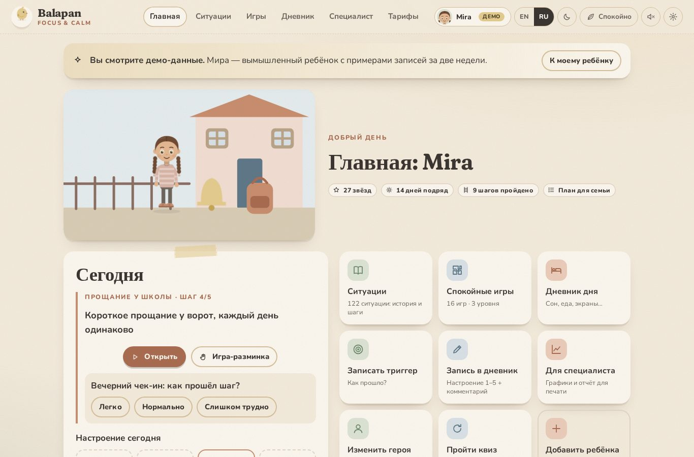
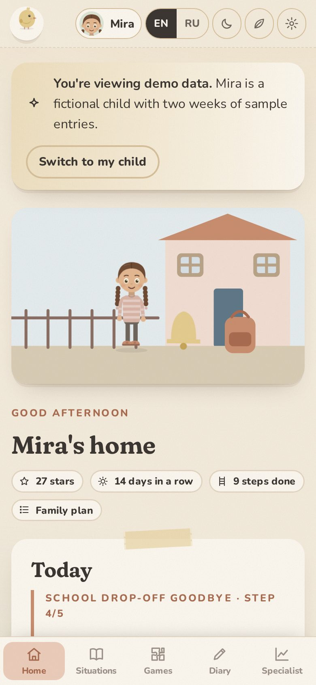
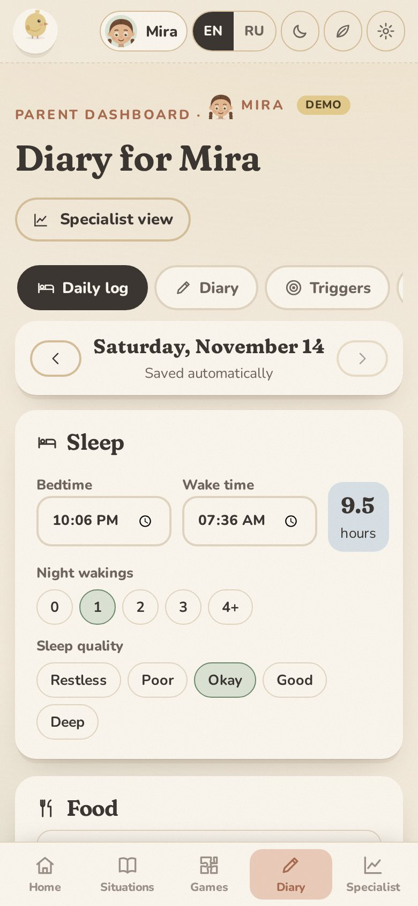
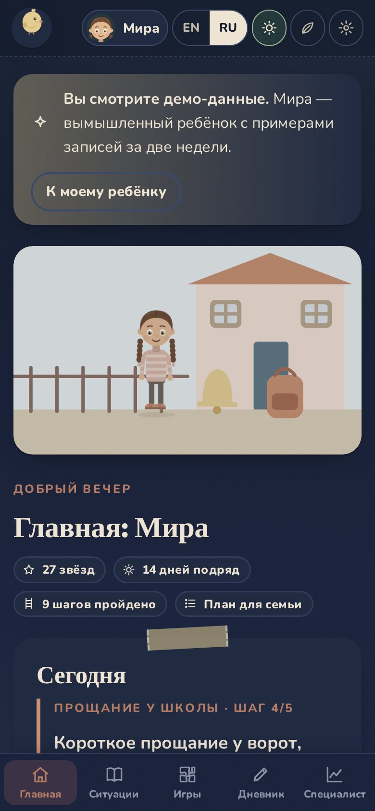

# Balapan Focus & Calm

**Brave plans, focus quests, calm games and a parent diary for kids 5–10 with anxiety, ADHD, or both. The child is the hero of every story.**

*Balapan* means "little chick" in Kazakh. It's our paper-cut mascot.

> Hackathon prototype for **Zimran Business Cup 2.0**. It's a static website: open it and start. No sign-up, no login, no server. All data stays in the browser's `localStorage`. Interface in **English and Russian**.

[English](#english) · [Русский](#русский)



---

## English

### Quick start

> **Downloaded the zip? Extract it first**, then open `index.html`. Opening `index.html` from inside the zip viewer breaks the CSS/JS paths.
> **Or just open `balapan-single.html`.** It's one self-contained file with all CSS and JS inlined, so it works on its own, even copied to another folder. Only Google Fonts load from the internet; without a connection it falls back to system fonts.

```bash
open index.html              # macOS (xdg-open on Linux, start on Windows)
# or any static server
python3 -m http.server 8080  # then http://localhost:8080
```

It runs from `file://`: data lives in classic JS files (no `fetch`, no ES modules), and routing is hash-based (`#/library`, `#/game/keys?lv=hard`, …).

### What's inside (v2)

| Area | What it does |
|---|---|
| **First run = quiz on the home screen** | With no child profile yet, home opens on "Let's get to know your child" with the first question already visible. The 7 steps are: name/age → what's hardest (+ anxiety / focus / both / not sure) → what the child fears → what the parent does when the child is scared → interests → motivators (+ safety check) → **Plan for your family**. Afterwards, home becomes that child's dashboard. You can retake the quiz any time. |
| **Skills track** | The parent learns one skill at a time: the words for this week (acceptance + confidence), habits to gently drop and what to try instead, and a 10-minute daily rhythm. |
| **122 situations** | 40 anxiety · 36 ADHD/focus · 46 both, in 7 categories (school, home, health, out & about, friends, travel, big feelings). Each one has why it's hard, 3 parent phrases, a 5-step ladder and a warm-up game. Filters, search (EN/RU) and lazy loading in batches of 18. |
| **Animated scene engine** | `js/core/scene.js` builds a unique SVG scene for every situation from a recipe `background|props|pose|fx|time` (28 backgrounds, ~70 props, 17 effects, day/evening/night). The scenes star the child's own avatar. They stop moving in Calm mode and under `prefers-reduced-motion`. |
| **Brave Plan / Routine Quest** | A 7-page story with the child as hero (scene per page, read aloud), a 5-rung ladder with stars and dates. Evening check-in: "too hard" splits the step into a mini step. |
| **16 games × 3 levels** | Easy / medium / hard. Two stars or more unlocks the next level, and progress is saved per child. Games go full-screen on phones. See the table below. |
| **Better voice** | Picks the most natural voice the device has (Natural / Neural / Premium / Enhanced / Google…). Per-language voice picker, slower default rate (0.86), pitch, and sentence chunking with pauses. There's an optional **neural TTS hook** (OpenAI-compatible `/audio/speech`): the key is entered in Settings and stays only in this browser. If the call fails, it falls back to the browser voice. |
| **Several children** | Child switcher in the header. Free: 1 child · Monthly: 2 · Yearly: up to 3. Adding a child starts the same quiz. |
| **Parent diary** | Mood 1–5, a comment and date/time. You can edit and delete entries, shown as a timeline. |
| **Daily log** | Quick chips and sliders. Sleep: bedtime, wake time, hours worked out automatically, night wakings, quality. Food: breakfast, lunch, dinner, snacks, what was eaten, appetite, sugar, new foods. Also medication (optional), activity, screen and outdoor minutes, tummy/bowel/illness, school or kindergarten yes/no, and notable events. |
| **Trigger outcome log** | Managed it / partly / didn't, plus intensity, reactions, what helped and a comment, linked to a situation. It feeds **adaptive next steps**: split the step, repeat it, or move on. |
| **Mood stickers** | 8 hand-drawn faces by time of day (morning, midday, after school, evening), with day and week views. |
| **Specialist tab** | Per-child summary, sleep-vs-mood chart, scatter with a trend line and Pearson *r*, trigger outcomes by day, screen time vs mood, a correlation table, a triggers table, moods by time of day, a daily-log table, diary entries and plans. Filters: 7/14/30 days, all or a custom range, plus specialist role and name. **Printable A4 report** in the chosen language ([EN sample](docs/sample-report-en.pdf), [RU sample](docs/sample-report-ru.pdf)), and per-child **JSON export/import**. |
| **Demo child** | "Mira", clearly labeled *demo*, with 2 weeks of realistic data. It's seeded on first launch but **not** active, so the first screen is still your own quiz. You can **clear the demo data** in Settings or Children (and restore it). |
| **Look** | The hand-crafted muted palette stays. Light "oat" theme plus a **dark theme on deep midnight navy** (#141c2e → #1b2540, lighter navy surfaces, oat text, dusty clay and soft sage accents, no neon). Calm mode, sound off by default. |
| **Mobile** | A fully responsive website (no PWA, no install prompt): bottom tab bar, bottom-sheet dialogs, full-screen games. |

### The games

| Game | Skill | Easy → Hard |
|---|---|---|
| Trail Tracer | Fine motor | 2 wide trails → 3 narrow trails |
| Lace It Up | Fine motor | 1 shoe, 6 holes → 10 + 12 holes |
| Dot-to-Dot | Fine motor + order | 2 pictures, big targets → 3 pictures, small targets |
| **Shape Tracing** *(new)* | Pre-writing | circle, square → star, drop, heart with a narrow outline |
| Button Jars | Fine motor + flexible attention | 6 buttons, colors only → 12 buttons + rule switch to shape |
| **Hero Puzzle** *(new)* | Fine motor + planning | 2×2 → 4×3 pieces of a scene with the child's hero |
| **Little to Big** *(new)* | Comparing & order | 3 very different dolls → 5–6 close sizes + reversed rule |
| Pack the Backpack | Planning / sequencing | 3 items, 1 toy → 5 items, 5 distractors |
| Balloon Breath | Calm body | 3 breaths, 3 s in / 4 s out → 6 breaths, 4 s in / 7 s out |
| Calm Bubbles | Self-control (go/no-go) | 30 s, few prickly, slow → 60 s, many prickly, faster |
| **Echo Drum** *(new)* | Timing & impulse control | steady beats → syncopated 5–6-beat rhythms, tighter timing |
| Hero Memory | Working memory | 4 pairs → 8 pairs |
| **Echo Garden** *(new)* | Memory for order (Simon) | 4 pads, chain of 4, slow → 6 pads, chain of 8, faster |
| **Spot It** *(new)* | Visual attention | 4×4, clear distractors → 6×6, look-alike colors, rotated |
| **Spot the Difference** *(new)* | Careful looking | 3 big changes → 7 subtle changes |
| **Keyboard Hunt** *(new)* | Visual search & letters | On-screen **Latin or Cyrillic** keyboard (follows the UI language). Single letters with a gentle hint → letter pairs, soft timer, a decoy glow → short words, faster timer, two decoys. Physical keyboard works too. |

### Ethics & safety

- Balapan is a **parenting support tool, not therapy and not a medical device**. It doesn't diagnose, treat or promise outcomes. It is **not affiliated with any university program**; it is only inspired by published research on parent-based approaches.
- **Red flags** (panic attacks, weeks of school refusal, self-harm, talk of death, danger) mean **no brave plan is built**. The parent sees "talk to a specialist" with **988** (US, call/text), **911**, Crisis Text Line (text HOME to 741741), and **112 / 150** for Kazakhstan. Plans unlock only if the parent confirms they already work with a specialist who agrees with small steps.
- Steps are gentle and the child is never forced. The language is acceptance plus confidence.
- **The child's name is never sent to an AI.** The LLM stub sends only age, interest, profile and the situation, and uses a `{name}` placeholder.
- Privacy: no accounts, no analytics, no server. Everything is in `localStorage` ("Reset all data" in the footer). The neural-voice key (if you add one) stays in this browser; for a public deployment, use a server-side proxy instead of a key.

### Build the single-file version

```bash
python3 build-single.py      # writes balapan-single.html (~600 KB)
```

The script inlines every stylesheet (print styles as `<style media="print">`) and every script between the `<!-- build:css -->` / `<!-- build:js -->` markers in `index.html`, and embeds the favicon. Run it again after changing any file.

### Deploy

- **Netlify:** drag the folder to app.netlify.com/drop, or connect the repo (`netlify.toml`: publish `.`, no build).
- **GitHub Pages:** Settings → Pages → Deploy from branch → `main` / root.
- **Vercel:** framework "Other", no build command, output `.`.

### Project structure

```
balapan-focus-calm/
├── index.html               # shell: header, tab bar, footer, print area, script list
├── balapan-single.html      # generated single-file build (python3 build-single.py)
├── build-single.py
├── css/  base · components · screens · games · v2 (new screens, scenes, dark navy theme, mobile) · print (A4 report)
├── js/
│   ├── i18n/i18n.js         # L(en, ru), language switch, plurals, dates
│   ├── data/                # situations.js, situations-2.js, situations-3.js (122), content.js, demo.js
│   ├── core/                # store (v2, multi-child), scene (SVG scene engine), engine (plans, adaptive steps, LLM stub),
│   │                        # voice (voice ranking, chunking, neural TTS), charts, avatar, router, ui, icons, sound
│   ├── screens/             # home (onboarding + dashboard), quiz, plan, library, brave, quest, games, diary,
│   │                        # specialist, family, settings, pricing, safety, about, builder
│   ├── games/               # 16 games: trail lace dots shapes jars puzzle sizes backpack balloon bubbles rhythm memory simon spot diff keys
│   └── app.js               # boot, header, child switcher, theme / calm / sound
├── docs/screenshots/        # curated JPG screenshots · docs/sample-report-*.pdf
└── netlify.toml · LICENSE
```

### Where to plug in the LLM

`BF.engine.generateWithLLM()` is a marked stub. Put your key in a **serverless function** (never in this repo), set `BF.config.llmEndpoint`, and return `{ story: { en:[7], ru:[7] } }` with a `{name}` placeholder. The template engine stays as the fallback.

### Payments

$0 (3 plans, 1 child) · **$12.99/month** (2 children) · **$79.99/year** (up to 3 children). `BF.config.stripeMonthly` / `stripeYearly` in `js/screens/pricing.js` are Stripe test-link placeholders, and checkout is simulated on this device.

### Screenshots

| | |
|---|---|
|  |  |
| First run: quiz on the home screen | 122 situations with animated scenes |
|  |  |
| Keyboard Hunt (medium) | Hero Puzzle |
|  |  |
| Daily log: sleep, food, day factors | Trigger outcome log + adaptive steps |
|  |  |
| Specialist tab (dark navy theme) | Printable A4 report |
|  |  |
| Voice settings | Russian interface |

Mobile (390 × 844):

<p>





</p>

All screenshots are in [`docs/screenshots/`](docs/screenshots/).

---

## Русский

**Balapan Focus & Calm** — сайт для родителей детей 5–10 лет с тревожностью, СДВГ или **и тем и другим сразу**. Ребёнок — главный герой каждой истории. Интерфейс на **русском и английском** (переключатель EN/RU в шапке запоминается).

### Как открыть

> **Скачали zip? Сначала распакуйте архив**, потом откройте `index.html`. Если открыть `index.html` прямо из архива, стили и скрипты не подгрузятся.
> **Или просто откройте `balapan-single.html`.** Это один самодостаточный файл со всеми стилями и скриптами внутри. Он работает сам по себе, даже если скопировать его в другую папку. Из интернета грузятся только шрифты Google; без сети используются системные.

Регистрации нет, сервера нет: все данные хранятся только в `localStorage` этого браузера.

### Что внутри (v2)

- **Первый запуск: квиз прямо на главной.** «Давайте познакомимся с вашим ребёнком», первый вопрос сразу на экране. 7 шагов: имя и возраст → что труднее всего → чего боится ребёнок → что делает родитель, когда ребёнку страшно → интересы → что мотивирует (+ проверка безопасности) → **план для вашей семьи**. После квиза главная становится кабинетом этого ребёнка. Квиз можно пройти заново.
- **Трек «Навыки»:** родитель осваивает по одному навыку — слова на неделю, привычки «мягко убрать → попробовать вместо», ритм по 10 минут в день.
- **122 ситуации** (40 тревожность · 36 СДВГ · 46 «оба») в 7 категориях. Фильтры, поиск, ленивая подгрузка. У каждой ситуации **своя анимированная SVG-сцена** с аватаром ребёнка; в спокойном режиме и при `prefers-reduced-motion` анимации выключаются.
- **16 игр, у каждой 3 уровня** (легко / средне / сложно). Две звезды открывают следующий уровень. Новые игры: «Охота за буквами» (экранная клавиатура, латиница или кириллица по языку интерфейса; сложность растёт за счёт таймера, отвлекающих подсветок и последовательностей букв), «Обведи фигуру», «Пазл с героем», «От маленького к большому», «Барабан-эхо», «Эхо-сад» (Simon), «Найди такие же», «Найди отличия». На телефоне игры открываются на весь экран.
- **Голос:** автоматически выбирается самый естественный голос устройства; можно выбрать голос для каждого языка. Медленнее по умолчанию, регулируются скорость и высота, текст читается по предложениям с паузами. Есть **подключение нейроголоса** (OpenAI-совместимый API): ключ вводится в настройках и хранится только в браузере. Если нейроголос недоступен, читает голос браузера.
- **Несколько детей:** переключатель в шапке. Бесплатно — 1 ребёнок, месячный тариф — 2, годовой — до 3.
- **Дневник родителя** (настроение 1–5, комментарий, дата и время, правка и удаление, лента записей).
- **Дневник дня:** сон (отбой, подъём, часы считаются сами, пробуждения, качество), еда (завтрак, обед, ужин, перекусы, аппетит, сладкое, новая еда), лекарства (необязательно), активность, экраны, улица, живот и самочувствие, школа или сад, события. Ввод в одно касание: чипы и ползунки.
- **Журнал триггеров:** справился / частично / не справился, интенсивность, реакции, что помогло, комментарий. На их основе приложение подсказывает следующий шаг: уменьшить, повторить или идти дальше.
- **Наклейки настроения** по времени суток, вид за день и за неделю.
- **Вкладка для специалиста:** графики (сон и настроение, точечная диаграмма с линией тренда и корреляцией, исходы триггеров, экраны и настроение), таблицы корреляций, триггеров и дневника дня. Фильтры по датам, **отчёт A4 для печати** на выбранном языке, экспорт и импорт JSON.
- **Демо-ребёнок «Мира»** с данными за 2 недели. Он помечен как демо и не мешает первому запуску; удалить его можно в настройках.
- **Тёмная тема** на глубоком ночном синем (#141c2e–#1b2540), приглушённые акценты (пыльная глина, мягкий шалфей, овсяный текст), без неона. Светлая тема — прежняя, приглушённая.
- **Мобильная версия** — обычный адаптивный сайт (не PWA): нижняя панель вкладок, диалоги снизу, игры на весь экран.

### Этика

Это **не терапия и не медицинское изделие**: приложение не ставит диагнозов и ничего не обещает. Оно **не связано** с университетскими программами, а лишь вдохновлено исследованиями подхода через родителя. При «красных флажках» (панические атаки, недели отказа от школы, самоповреждение, мысли о смерти) план **не строится**: показываем «обратитесь к специалисту» и номера **988 / 911** (США), **112 / 150** (Казахстан). Шаги мягкие, ребёнка не заставляют. **Имя ребёнка никогда не отправляется в ИИ.**

### Сборка одного файла

```bash
python3 build-single.py   # создаёт balapan-single.html
```

---

## License

[MIT](LICENSE)
