# Balapan Focus & Calm

**Brave plans, calm games and a parent diary for kids 5–10 with anxiety, ADHD, or both. The child is the hero of every story.**

*Balapan* means "little chick" in Kazakh. It is our paper-cut mascot.

A hackathon prototype for **Zimran Business Cup 2.0**. Open the site and start: no sign-up, no login, no server. Everything the family types stays in this browser's `localStorage`. The interface is in **English and Russian**.

**Team:** StarLight Team · Zimran Business Cup 2.0

**Live demo:** [balapan-focus-calm.vercel.app](https://balapan-focus-calm.vercel.app)

**Pitch deck (PDF, RU):** [docs/Balapan-pitch.pdf](docs/Balapan-pitch.pdf)

[English](#english) · [Русский](#русский)

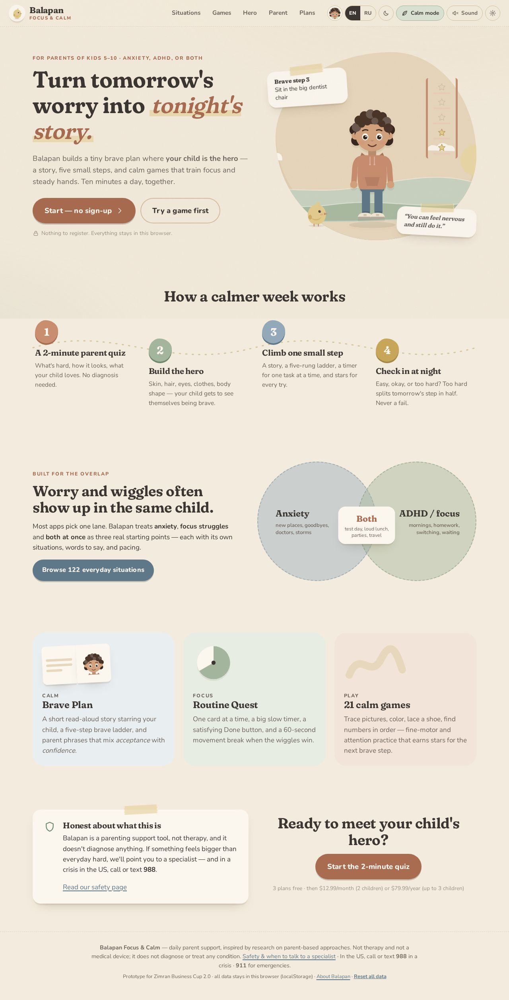

---

## English

### The problem

Tomorrow something new is coming: a dentist visit, a haircut, the first day at a new school. The child does not know what will happen. The parent looks for the right words, and later nobody quite remembers what helped.

We work with children with special educational needs, and we see this often: a child with ADHD copes more easily when they already know the plan.

### Who it is for

Parents in the United States whose children are 5–10 and live with anxiety, ADHD, or both. The parent organizes the preparation; the child goes through the story and the small steps with them.

### How it works

1. **The event.** The parent picks an upcoming situation, for example a dentist visit or a new school.
2. **The story and the small steps.** The child becomes the hero of a short story and climbs a five-step ladder.
3. **Phrases for the parent.** Ready wording for what to say, and what to ease off on.
4. **How it went.** After the event the parent notes what happened and what helped. That note shapes the next step.

Stories in the prototype are built from templates. An AI hook is already in the code for later, when stories can be written for a specific child. The child's name is never sent out.

### What's in the prototype

- **Home** at `#/` is the landing page, in English and Russian, with live counts. The first visit opens a 7-step quiz at `#/welcome` ("Let's get to know your child"). The parent dashboard lives at `#/parent`.
- **122 situations:** 40 anxiety, 36 ADHD/focus, 46 both, in 7 categories (school, home, health, out and about, friends, travel, big feelings). Each one has its own animated scene, a short "why it's hard," 3 parent phrases, a 5-step ladder and a warm-up game. Filters, search in both languages, and loading in batches of 18.
- **Scene engine.** A unique SVG scene for every situation, built from a short recipe. 28 backgrounds, 79 props, 17 effects, day, evening or night. The child's own avatar is in the picture. Motion stops in Calm mode and when the system asks for less motion.
- **Brave Plan and Routine Quest.** A 7-page story with the child as hero, and a 5-rung ladder with stars and dates. If a step was too hard, the evening check-in splits it into a smaller one.
- **21 games, each with three levels** (easy, medium, hard). Two stars or more unlock the next level. Progress is saved per child. On a phone the games open full screen.
- **Character builder** at `#/hero`, so the child can look like themselves in the stories and games.
- **Voice.** The app picks a natural voice on the device, with speed, pitch and a per-language voice picker. There is an optional neural-voice hook in Settings; the key stays in this browser, and the built-in voice is the fallback.
- **More than one child.** A switcher in the header. Free plan: 1 child. Monthly: 2. Yearly: up to 3.
- **Parent diary** with mood 1–5, a comment, and a timeline you can edit.
- **Daily log** for sleep, food, activity, screens, outdoor time, and the rest of the day, mostly with chips and sliders.
- **Trigger log:** managed it, partly, or didn't, plus what helped. The next step can get smaller, be repeated, or move on.
- **8 mood stickers** for morning, midday, after school and evening, with day and week views.
- **Specialist tab:** charts, tables, date filters, a [printable A4 report](docs/sample-report-en.pdf) in the current language, and JSON export/import per child.
- **Demo child "Mira,"** clearly labeled, with two weeks of sample data. She is seeded on first launch but not made active, so the first screen is still your own quiz. You can clear or restore the demo in Settings.
- **Look.** A muted light "oat" theme and a dark theme on deep navy. Sound is off by default.
- **Mobile.** A responsive website (not a PWA): bottom tab bar, bottom-sheet dialogs, full-screen games.

### The games

The games develop fine motor skills and help a child calm down during or after a meltdown, when something new and unfamiliar has thrown them off. Each game takes about 1–3 minutes.

| Game | Skill |
|---|---|
| Picture Tracing | Fine motor and focus |
| Coloring | Fine motor and attention |
| Trail Tracer | Fine motor |
| Shape Tracing | Fine motor |
| Lace It Up | Fine motor |
| Dot-to-Dot | Fine motor |
| Button Jars | Fine motor |
| Hero Puzzle | Fine motor and planning |
| Little to Big | Comparing and order |
| Number Hunt | Focus and visual search |
| Follow the Robot | Attention and spatial memory |
| What Changed? | Attention and memory |
| Spot It | Visual attention |
| Spot the Difference | Careful looking |
| Keyboard Hunt | Visual search and letters (Latin or Cyrillic, following the interface language) |
| Pack the Backpack | Planning and order |
| Hero Memory | Working memory |
| Echo Garden | Memory for order |
| Echo Drum | Timing and self-control |
| Balloon Breath | Calm body |
| Calm Bubbles | Focus and self-control |

### Safety and ethics

Balapan is a parenting support tool. It is not a medical product. It does not diagnose, treat, or replace therapy, and it does not promise outcomes. It is not affiliated with any university program; the wording is only inspired by published research on parent-based approaches.

If the quiz or a plan hits a serious red flag, no brave plan is built. The parent is asked to talk to a specialist, and the in-app [safety page](https://balapan-focus-calm.vercel.app/#/safety) lists crisis contacts for the United States and Kazakhstan.

Steps stay small, and the child is never forced. The phrases mix acceptance and confidence.

Privacy: no accounts, no analytics, no server. Names, diary entries and progress live only in `localStorage` on this device ("Reset all data" is in the footer). If an AI story service is connected later, only the situation description is sent, never the child's name. A neural-voice key, if you add one, also stays in this browser.

### Tech stack

Vanilla HTML, CSS and JavaScript. No framework, no bundler, no build step to run the app. Routing is hash-based (`#/library`, `#/game/keys?lv=hard`), and the data lives in classic script tags, so the site works from `file://`.

### Run it locally

If you downloaded a zip, extract it first, then open `index.html`. Opening the file from inside a zip viewer breaks the CSS and JS paths.

Or open `balapan-single.html`. That file has all the CSS and JS inlined, so it works on its own, even if you copy it to another folder. Only Google Fonts load from the internet; without a connection the page falls back to system fonts.

```bash
open index.html              # macOS (xdg-open on Linux, start on Windows)
# or any static server
python3 -m http.server 8080  # then http://localhost:8080
```

### Single-file build

```bash
python3 build-single.py      # writes balapan-single.html (about 680 KB)
```

The script inlines every stylesheet (print styles as `<style media="print">`) and every script between the `<!-- build:css -->` / `<!-- build:js -->` markers in `index.html`, and embeds the favicon. Run it again after changing any source file.

### Project structure

```
balapan-focus-calm/
├── index.html               # shell: header, tab bar, footer, print area, script list
├── balapan-single.html      # generated single-file build
├── build-single.py
├── css/                     # base, components, screens, games, v2, print
├── js/
│   ├── i18n/i18n.js         # EN/RU, plurals, dates
│   ├── data/                # 122 situations, phrases, stories, demo child
│   ├── core/                # store, scene engine, plan engine (LLM stub), voice, router
│   ├── screens/             # home, welcome, parent, library, games, diary, specialist…
│   ├── games/               # 21 games
│   └── app.js               # boot, header, child switcher, theme / calm / sound
├── docs/screenshots/        # JPG screenshots and sample A4 reports
├── tools/qa/                # Playwright click tests (see tools/qa/README.md)
└── LICENSE                  # MIT, Copyright (c) 2026 StarLight Team
```

To plug in a real model later, use `BF.engine.generateWithLLM()`. Put the key in a serverless function, never in this repo, set `BF.config.llmEndpoint`, and return `{ story: { en:[7], ru:[7] } }` with a `{name}` placeholder. The template engine stays as the fallback.

Proposed price on the Plans page: **$12.99 a month** (2 children) or **$79.99 a year** (up to 3). The free tier covers 3 plans and 1 child. Checkout in the prototype is only a simulation.

### QA tools

Developer click tests in `tools/qa/`, written in Python with Playwright. They are not needed to run the app. See [`tools/qa/README.md`](tools/qa/README.md) for how to crawl every screen, click every control, and summarize results from `/tmp/crawl`.

### Roadmap

- **Month 1.** Ten interviews with parents, and an expert review of the stories and phrases.
- **Months 2–3.** A pilot with 20 families, for two weeks, following the real cycle: prepare, try, write down how it went.
- **Months 4–5.** AI-generated stories for a specific child. The hook is already in the code.
- **Month 6.** A $12.99 monthly subscription, starting with families in parent communities.

### Team

StarLight Team. We study informatics at Astana International University and already work with children with special educational needs. We break hard things into steps a child can follow.

- **Казкен Аяулым**, Informatics, AIU
- **Серікбек Жулдыз**, Informatics, AIU

### Screenshots

| | |
|---|---|
| 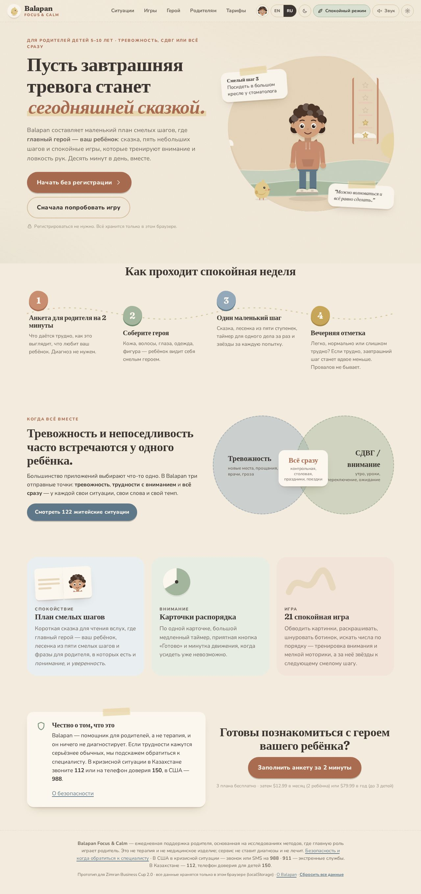 | 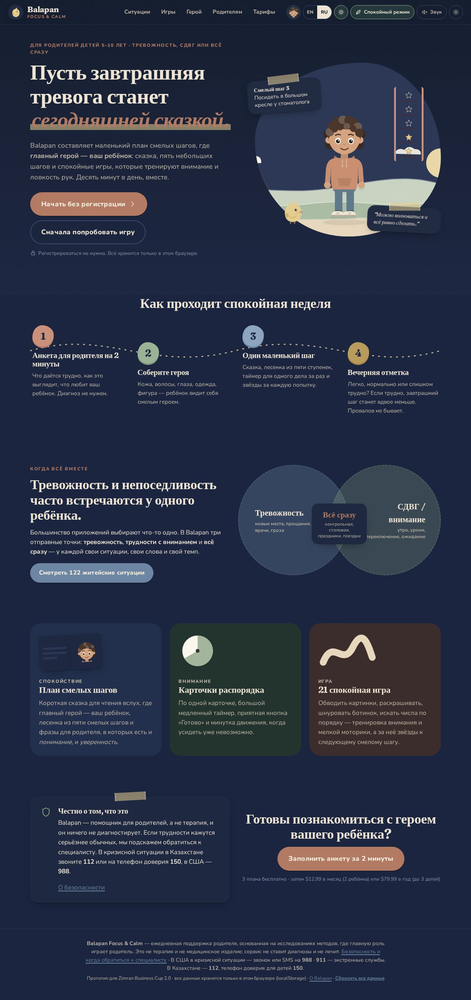 |
| Home in Russian | Home, dark theme |
|  |  |
| First run: the parent quiz | 122 situations with animated scenes |
| 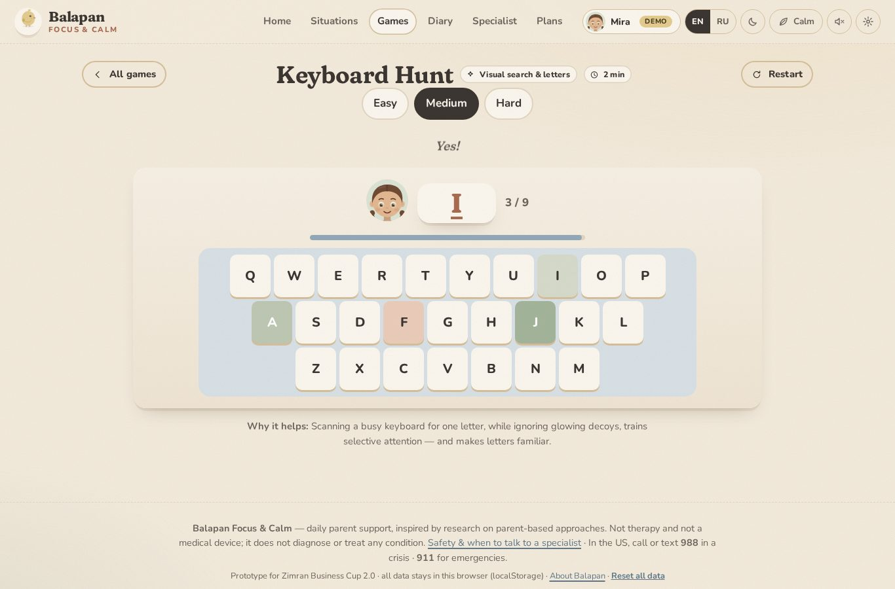 |  |
| Keyboard Hunt | Hero Puzzle |
| 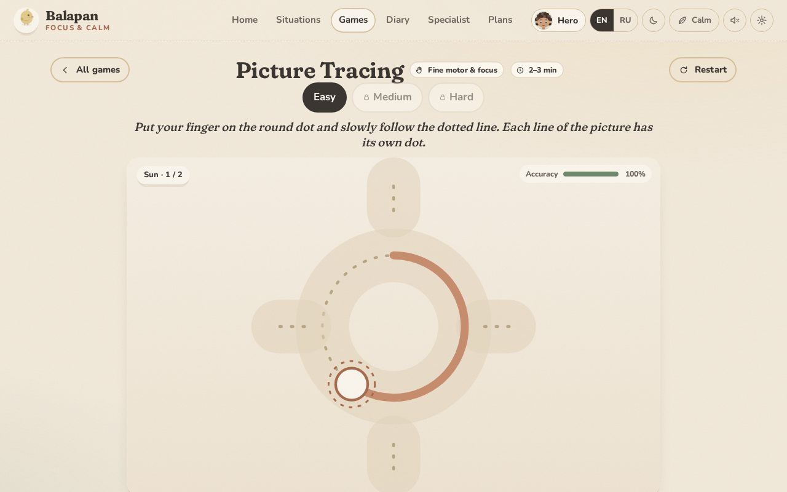 | 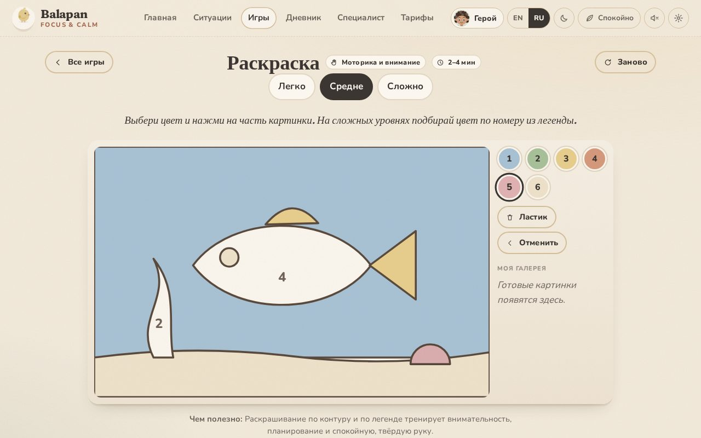 |
| Picture Tracing | Coloring (Russian) |
| 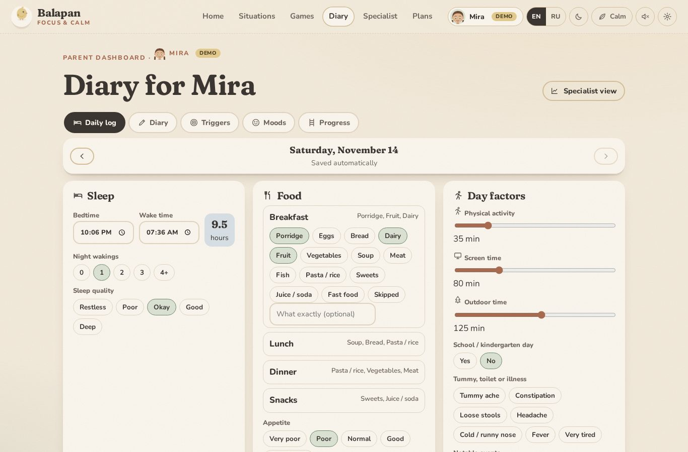 | 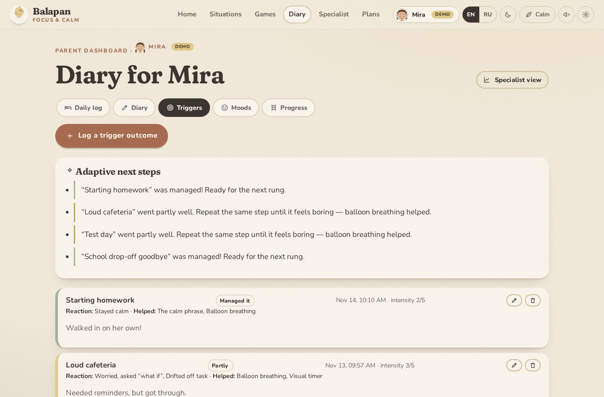 |
| Daily log: sleep, food, the day | How it went, and the next step |
| 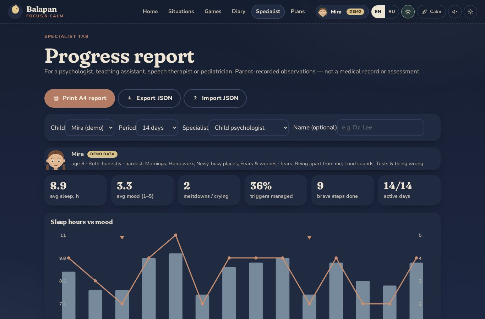 | 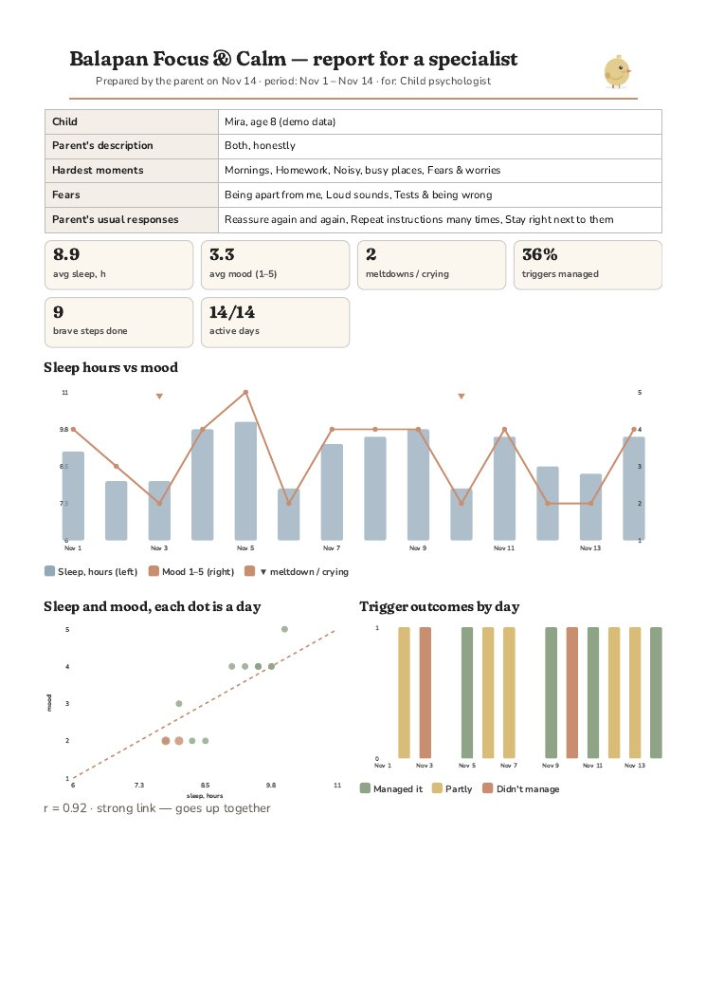 |
| Specialist tab (dark theme) | Printable A4 report |
|  | 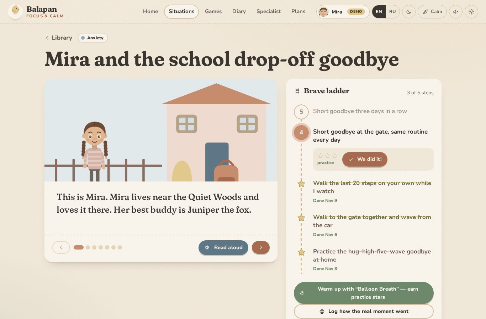 |
| Voice settings | Brave Plan story |

Mobile (390 × 844):

<p>
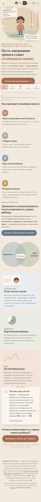
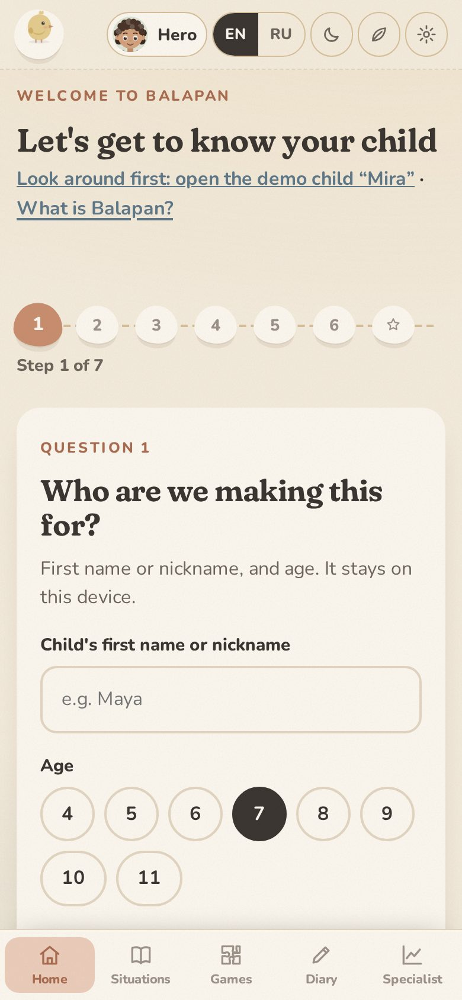

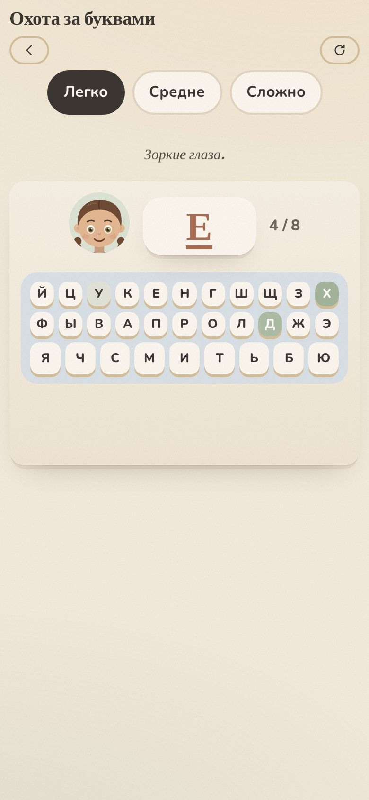
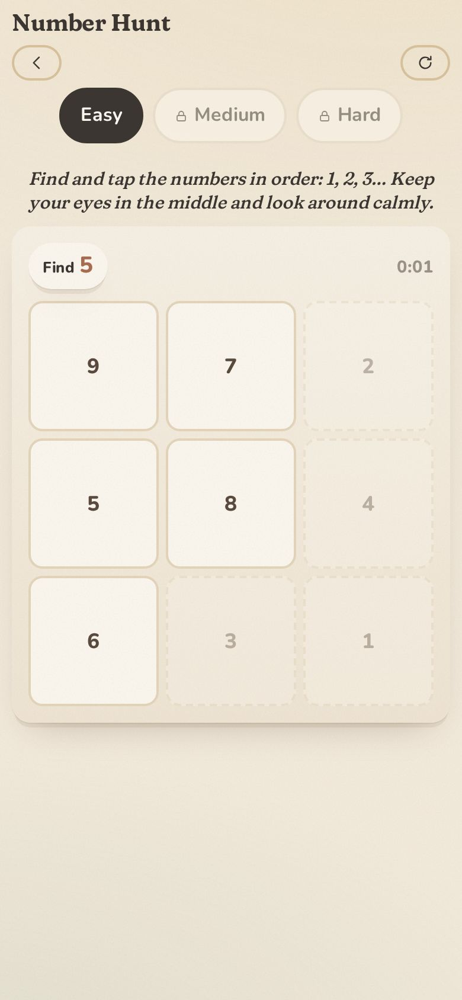


</p>

All screenshots are in [`docs/screenshots/`](docs/screenshots/). Sample reports: [English](docs/sample-report-en.pdf), [Russian](docs/sample-report-ru.pdf).

---

## Русский

**Balapan Focus & Calm** помогает родителям детей 5–10 лет с тревожностью, СДВГ или и тем и другим сразу. Ребёнок здесь главный герой каждой истории. Интерфейс на русском и английском (переключатель EN/RU в шапке запоминается).

**Живое демо:** [balapan-focus-calm.vercel.app](https://balapan-focus-calm.vercel.app)

**Презентация (PDF):** [docs/Balapan-pitch.pdf](docs/Balapan-pitch.pdf)

### Проблема

Завтра что-то новое: стоматолог, стрижка, первый день в новой школе. Ребёнку непонятно, что его ждёт. Родителю трудно найти слова, а потом уже не вспомнить, что в тот раз помогло.

Мы работаем с детьми с ООП и часто это видим: ребёнку с СДВГ легче, когда он заранее знает план.

### Для кого

Для родителей в США, у которых дети 5–10 лет с тревожностью, СДВГ или и тем и другим. Готовится и всё организует родитель, ребёнок проходит историю и шаги вместе с ним.

### Как это работает

1. **Событие.** Родитель выбирает предстоящую ситуацию, например визит к стоматологу или новую школу.
2. **История и маленькие шаги.** Ребёнок становится героем короткой истории и поднимается по лесенке из пяти ступеней.
3. **Фразы для родителя.** Готовые слова: что сказать и от чего лучше чуть отступить.
4. **Как всё прошло.** После события родитель отмечает, что случилось и что помогло. Эта запись подсказывает следующий шаг.

Пока истории собираются из шаблонов. Подключение ИИ уже есть в коде: позже история сможет писаться под конкретного ребёнка. Имя ребёнка при этом никуда не уходит.

### Что есть в прототипе

- **Главная** (`#/`) открывает лендинг на русском и английском, с живыми счётчиками. При первом запуске открывается квиз из 7 шагов на `#/welcome` («Давайте познакомимся с ребёнком»). Кабинет родителя находится на `#/parent`.
- **122 ситуации:** 40 про тревожность, 36 про СДВГ и внимание, 46 про оба сразу, в 7 категориях (школа, дом, здоровье, улица, друзья, поездки, сильные чувства). У каждой своя анимированная сцена, коротко «почему это трудно», 3 фразы для родителя, лесенка из 5 шагов и игра-разминка. Фильтры, поиск на двух языках, подгрузка пачками по 18.
- **Движок сцен.** Уникальная SVG-сцена для каждой ситуации из короткого рецепта. 28 фонов, 79 предметов, 17 эффектов, день, вечер или ночь. В кадре аватар самого ребёнка. В спокойном режиме и при просьбе системы уменьшить движение анимация выключается.
- **План смелых шагов и карточки распорядка.** История на 7 страниц, где ребёнок главный герой, и лесенка из 5 ступеней со звёздами и датами. Если шаг оказался слишком трудным, вечерняя отметка делит его на более мелкий.
- **21 игра, у каждой три уровня** (легко, средне, сложно). Две звезды и больше открывают следующий уровень. Прогресс хранится отдельно для каждого ребёнка. На телефоне игры открываются на весь экран.
- **Конструктор героя** на `#/hero`: ребёнок может быть похож на себя в историях и играх.
- **Голос.** Приложение выбирает наиболее естественный голос на устройстве, можно настроить скорость, высоту и голос для каждого языка. В настройках есть подключение нейроголоса: ключ остаётся в этом браузере, а если нейроголос недоступен, читает обычный голос устройства.
- **Несколько детей.** Переключатель в шапке. Бесплатно: 1 ребёнок, месяц: 2, год: до 3.
- **Дневник родителя:** настроение 1–5, комментарий, лента записей, которые можно править.
- **Дневник дня:** сон, еда, активность, экраны, улица и остальное, в основном чипами и ползунками.
- **Журнал трудных моментов:** справился, частично или не справился, и что помогло. Следующий шаг можно уменьшить, повторить или идти дальше.
- **8 наклеек настроения** на утро, день, после школы и вечер, вид за день и за неделю.
- **Вкладка для специалиста:** графики, таблицы, фильтры по датам, [отчёт A4 для печати](docs/sample-report-ru.pdf) на выбранном языке, экспорт и импорт JSON по каждому ребёнку.
- **Демо-ребёнок «Мира»**, явно помечен как демо, с данными за две недели. При первом запуске она появляется в данных, но не становится активной, поэтому сначала всё равно ваш квиз. Удалить или вернуть демо можно в настройках.
- **Внешний вид.** Светлая приглушённая «овсяная» тема и тёмная на глубоком синем. Звук по умолчанию выключен.
- **Мобильная версия.** Обычный адаптивный сайт, не PWA: нижняя панель вкладок, диалоги снизу, игры на весь экран.

### Игры

Игры развивают мелкую моторику и помогают ребёнку успокоиться во время срыва или после него, когда его выбило что-то новое и незнакомое. Каждая занимает примерно 1–3 минуты.

| Игра | Навык |
|---|---|
| Обводка картинок | Моторика и внимание |
| Раскраска | Моторика и внимание |
| Тропинка | Мелкая моторика |
| Обведи фигуру | Мелкая моторика |
| Зашнуруй | Мелкая моторика |
| По точкам | Мелкая моторика |
| Баночки с пуговицами | Мелкая моторика |
| Пазл с героем | Моторика и планирование |
| От маленького к большому | Сравнение и порядок |
| Найди числа по порядку | Концентрация и поиск |
| Догони робота | Внимание и пространство |
| Что изменилось? | Внимание и память |
| Найди такие же | Зрительное внимание |
| Найди отличия | Внимательный взгляд |
| Охота за буквами | Зрительный поиск и буквы (латиница или кириллица, по языку интерфейса) |
| Собери рюкзак | Планирование и порядок |
| Память героя | Рабочая память |
| Эхо-сад | Память на порядок |
| Барабан-эхо | Ритм и самоконтроль |
| Дыхание-шарик | Спокойное тело |
| Спокойные пузыри | Внимание и самоконтроль |

### Безопасность и этика

Balapan задуман как поддержка родителя. Это не медицинский продукт. Приложение не ставит диагноз, не лечит и не заменяет терапию, и ничего не обещает. Оно не связано с университетскими программами; формулировки лишь опираются на опубликованные исследования подхода, где главную роль играет родитель.

Если в квизе или в плане появляется серьёзный сигнал, план смелых шагов не строится. Родителя просят обратиться к специалисту, а на [странице безопасности](https://balapan-focus-calm.vercel.app/#/safety) собраны кризисные контакты для США и Казахстана.

Шаги мягкие, ребёнка не заставляют. Во фразах есть и принятие, и уверенность.

Конфиденциальность: нет аккаунтов, нет аналитики, нет сервера. Имена, дневник и прогресс хранятся только в `localStorage` на этом устройстве (в подвале есть «Сбросить все данные»). Если позже подключить ИИ для историй, туда уйдёт только описание ситуации, никогда имя ребёнка. Ключ нейроголоса, если его указать, тоже остаётся в этом браузере.

### Технологии

Обычные HTML, CSS и JavaScript. Без фреймворка, без сборщика, без отдельной сборки, чтобы просто открыть сайт. Маршруты на хеше (`#/library`, `#/game/keys?lv=hard`), данные в обычных скриптах, поэтому всё работает даже с `file://`.

### Как открыть у себя

Скачали zip? Сначала распакуйте архив, потом откройте `index.html`. Если открыть файл прямо из архива, стили и скрипты не подгрузятся.

Или просто откройте `balapan-single.html`. Это один самодостаточный файл со всеми стилями и скриптами внутри. Он работает сам по себе, даже если скопировать его в другую папку. Из интернета грузятся только шрифты Google; без сети используются системные.

```bash
open index.html              # macOS (xdg-open в Linux, start в Windows)
# или любой статический сервер
python3 -m http.server 8080  # затем http://localhost:8080
```

### Сборка одного файла

```bash
python3 build-single.py      # создаёт balapan-single.html (около 680 КБ)
```

Скрипт встраивает все стили (печатные как `<style media="print">`) и все скрипты между маркерами `<!-- build:css -->` / `<!-- build:js -->` в `index.html`, а также иконку. После правок в исходниках запустите его снова.

### Структура проекта

Та же, что в английской части выше: `index.html`, `js/data` (122 ситуации), `js/games` (21 игра), `js/core` (хранилище, сцены, движок планов, голос, маршруты), `tools/qa`, `docs/screenshots`.

Чтобы позже подключить настоящую модель, используйте `BF.engine.generateWithLLM()`. Ключ держите в серверной функции, не в этом репозитории, задайте `BF.config.llmEndpoint` и верните `{ story: { en:[7], ru:[7] } }` с плейсхолдером `{name}`. Шаблоны остаются запасным вариантом.

Предлагаемая цена на странице тарифов: **$12.99 в месяц** (2 ребёнка) или **$79.99 в год** (до 3). Бесплатно: 3 плана и 1 ребёнок. Оплата в прототипе только имитируется.

### Проверка качества

В `tools/qa/` лежат клик-тесты для разработчиков на Python и Playwright. Чтобы просто запустить приложение, они не нужны. Как проходить все экраны и собирать результаты из `/tmp/crawl`, написано в [`tools/qa/README.md`](tools/qa/README.md).

### Дорожная карта

- **Месяц 1.** Десять интервью с родителями и проверка историй и фраз экспертом.
- **Месяцы 2–3.** Пилот на 20 семей, две недели, по настоящему циклу: подготовиться, попробовать, записать, как прошло.
- **Месяцы 4–5.** Истории, которые пишет ИИ под конкретного ребёнка. Точка подключения уже есть в коде.
- **Месяц 6.** Подписка $12.99 в месяц, сначала через родительские сообщества.

### Команда

StarLight Team. Мы учимся на учителей информатики в Astana International University и уже работаем с детьми с ООП. Сложное разбираем на шаги, которые ребёнку посильны.

- **Казкен Аяулым**, Информатика, AIU
- **Серікбек Жулдыз**, Информатика, AIU

---

## License

[MIT](LICENSE) · Copyright (c) 2026 StarLight Team
