# Balapan Focus & Calm

**Brave plans, focus quests and calm fine-motor games for kids 5–10 with anxiety, ADHD, or both, all starring the child as the hero.**

*Balapan* means "little chick" in Kazakh. It's our paper-cut mascot.

> Hackathon prototype for **Zimran Business Cup 2.0**. It's a static web app: open the link and start. There's no sign-up or login, and every bit of data stays in the browser's `localStorage`.

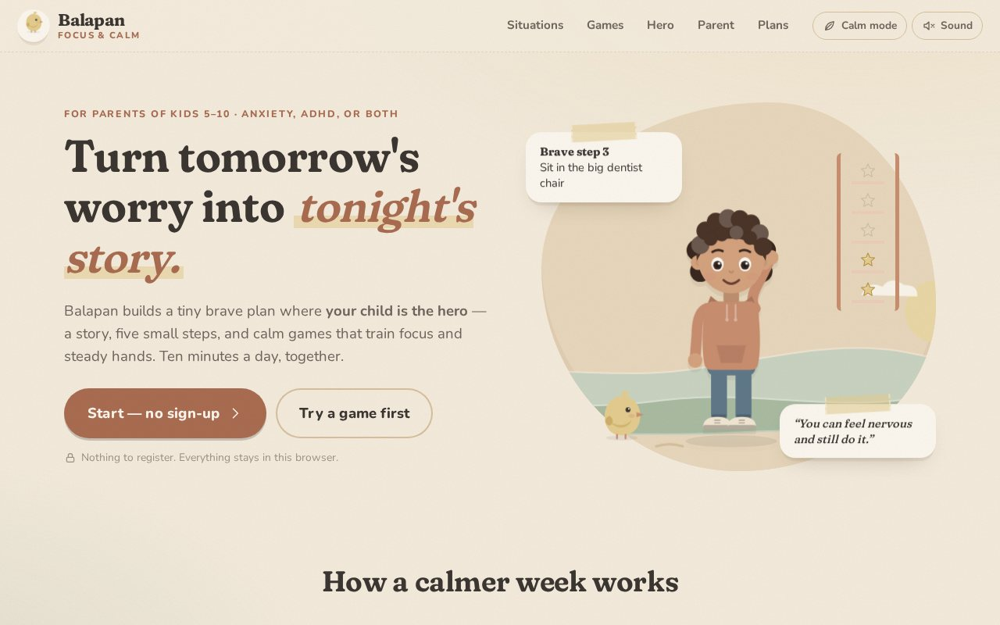

---

## What it is

Balapan is a B2C web service for US parents (25–45) of children aged 5–10 who struggle with **worry and fears**, **focus and starting tasks**, or **both at the same time**. Most tools pick one lane. Balapan treats the overlap as its own real starting point.

1. **Parent quiz (7 steps).** It covers the child's name, age and pronoun, then what feels closest (anxiety / focus / both / not sure), the hardest moments, typical reactions, interests, what the parent usually tries, and a safety check. Two encouragement screens sit between the steps. If the safety check finds a red flag, the parent is routed to "talk to a specialist" plus US **988**.
2. **Character builder.** Parents build a hero that looks like their child: 10 skin tones, 8 hairstyles, 8 hair colors, 6 eye colors, 4 tops and 10 top colors, 4 bottoms and 6 colors, 3 shoe types and 5 colors, 3 body builds (slim / medium / chubby), plus glasses, ear muffs or freckles. It's a live layered SVG that blinks and breathes.
3. **Family plan.** It shows three recommended situations, "words for this week" (acceptance + confidence), "gently drop → try instead" habits, and a 10-minutes-a-day rhythm.
4. **Situation library.** 32 everyday moments: **12 Anxiety · 10 ADHD/Focus · 10 Both**. Each one has why it's hard, 3 parent phrases, and a 5-step ladder or routine. You can filter by tag and place, and search by text.
5. **Brave Plan (Calm).** A 7-page story where the child is the hero. It walks through the scene with their buddy and can be read aloud (Web Speech API). It also has a 5-rung brave ladder with stars and dates, a parent tips panel and habits to drop.
6. **Routine Quest (Focus).** One card at a time, a big Time-Timer-style visual timer, a satisfying **Done!** button with stars, and a 60-second movement break with the hero animated.
7. **8 mini-games** (1–3 min each, mouse and touch). Stars count as practice toward the current brave step.
8. **Parent dashboard.** It has a streak plant, stars, a completed-steps timeline with dates, and an **evening check-in** (easy / okay / too hard). "Too hard" automatically **splits the next step** into a smaller mini step. There's also a **printable summary for the doctor** (`window.print` with a print stylesheet).
9. **Pricing / paywall.** 3 free plans, then **$12.99/month** or **$79.99/year**. Checkout is a Stripe test-link placeholder, with an honest cancel note.
10. **Safety & disclaimer.** The app is not therapy, makes no medical claims, lists red flags with a "talk to a specialist" prompt, and shows 988 / 911 / Crisis Text Line.

### The games

| Game | Skill | What the child does |
|---|---|---|
| **Trail Tracer** | Fine motor | Keeps a finger on a winding trail and guides the hero home. Slipping off pauses progress but never resets it. 3 trails. |
| **Lace It Up** | Fine motor | Pulls the shoelace tip from eyelet to eyelet in number order, then a bow appears. 2 shoes. |
| **Dot-to-Dot** | Fine motor + order | Slides from dot to dot to reveal a star, a house and a fish. |
| **Button Jars** | Fine motor + flexible attention | Drags buttons into jars by color, then the rule switches to shape. |
| **Pack the Backpack** | Planning / sequencing | Packs the school items in checklist order. Toys stay home. |
| **Balloon Breath** | Calm body | Holds to breathe in (4 s) and lets go to breathe out (6 s). 5 balloons. |
| **Calm Bubbles** | Self-control (go/no-go) | Pops only the smooth calm bubbles and lets the prickly ones float away. 45 s. |
| **Hero Memory** | Working memory | A 6-pair memory game. One pair is the child's own hero. |

### Design choices

- The palette is muted on purpose (oat, sand, warm clay, sage, dusty blue, soft charcoal) so nothing shouts at a sensitive child. There are no neons, no pure reds and no flashing.
- It has a hand-made, paper-cut, children's-book feel: inline SVG illustrations, organic blob shapes, tape strips, dashed "stitch" lines and an SVG-noise paper grain. Type is **Fraunces** (display) with **Nunito** (body), with system fallbacks.
- The app respects `prefers-reduced-motion`. A **Calm mode** toggle cuts motion to almost nothing and silences sound. Soft Web Audio sounds are **off by default**.
- There are no emoji icons. Every icon and illustration is hand-built SVG.

---

## Screenshots

| | |
|---|---|
| 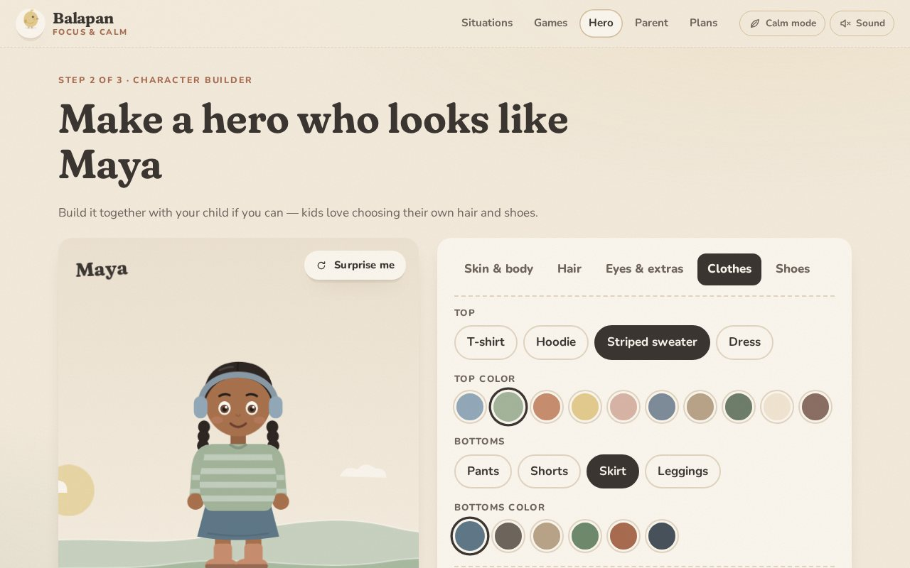 | 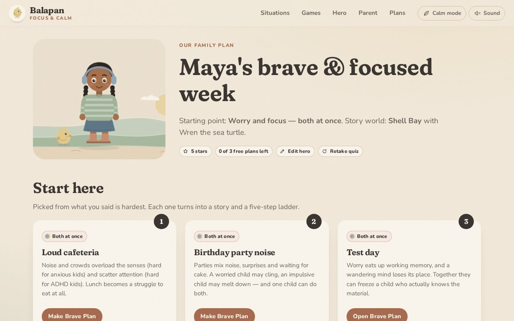 |
| Character builder | Family plan |
| 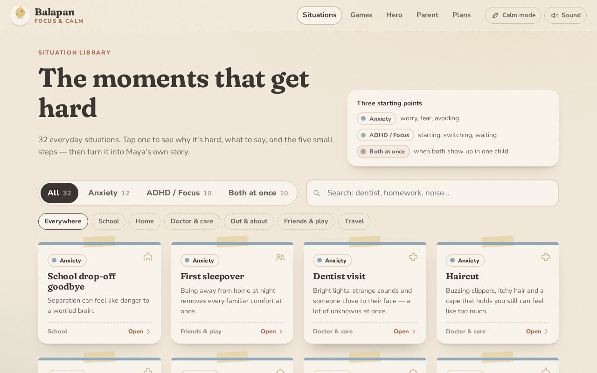 | 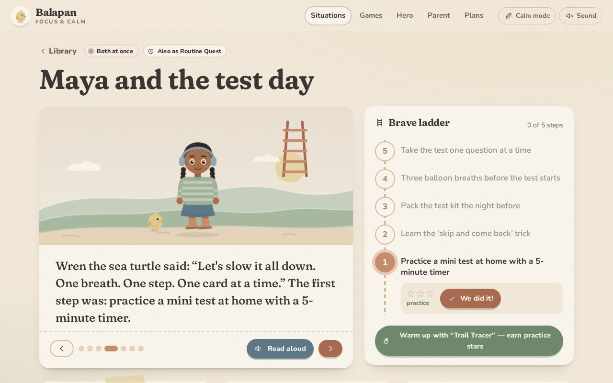 |
| Situation library (Anxiety / ADHD / Both) | Brave Plan: story + ladder |
| 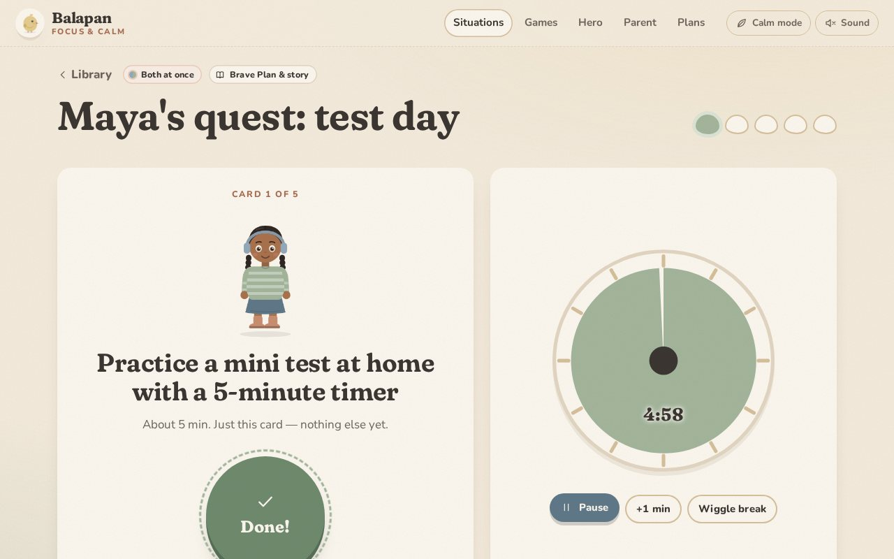 | 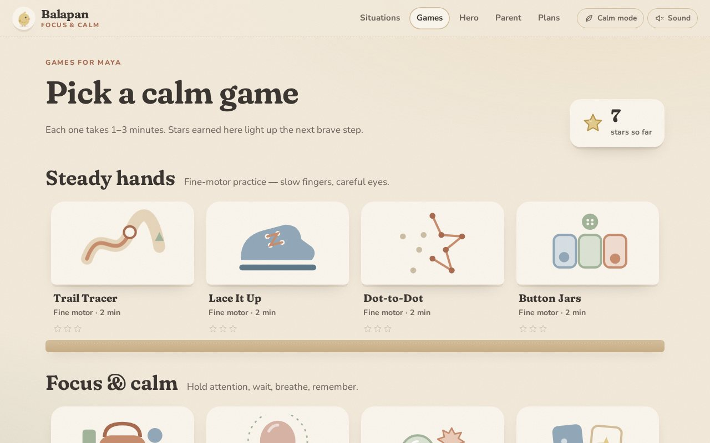 |
| Routine Quest with the visual timer | Games shelf |
| 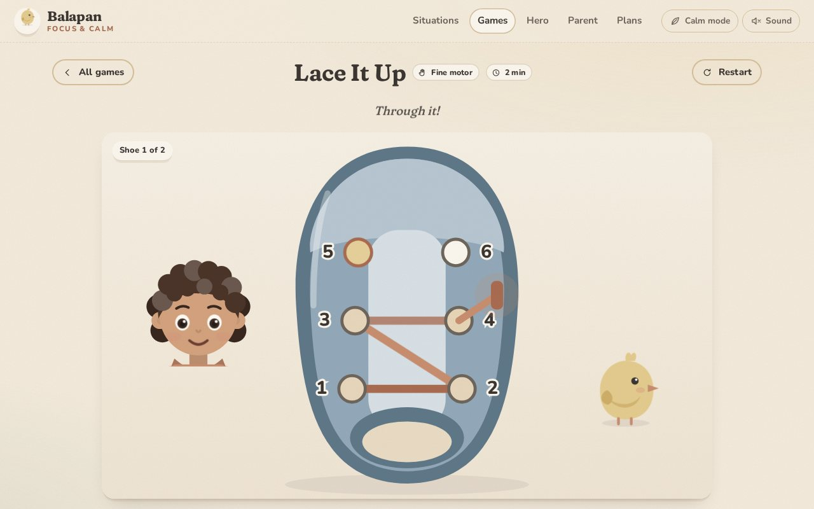 | 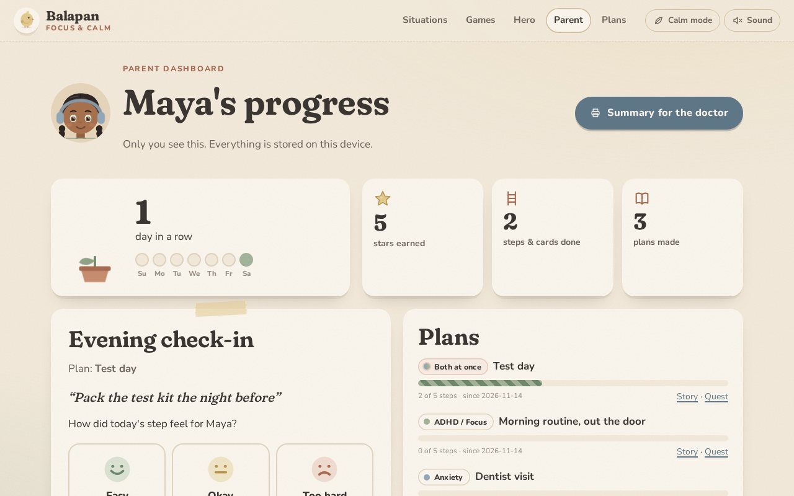 |
| Lace It Up (fine motor) | Parent dashboard + evening check-in |

Mobile (390 × 844):

<p>
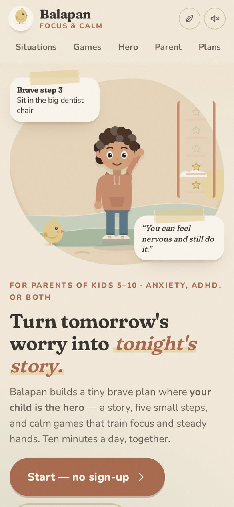
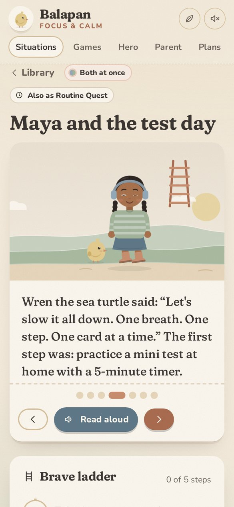
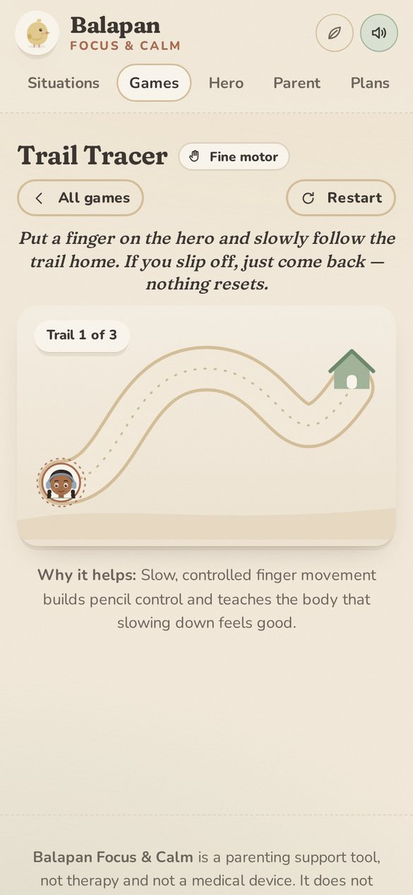
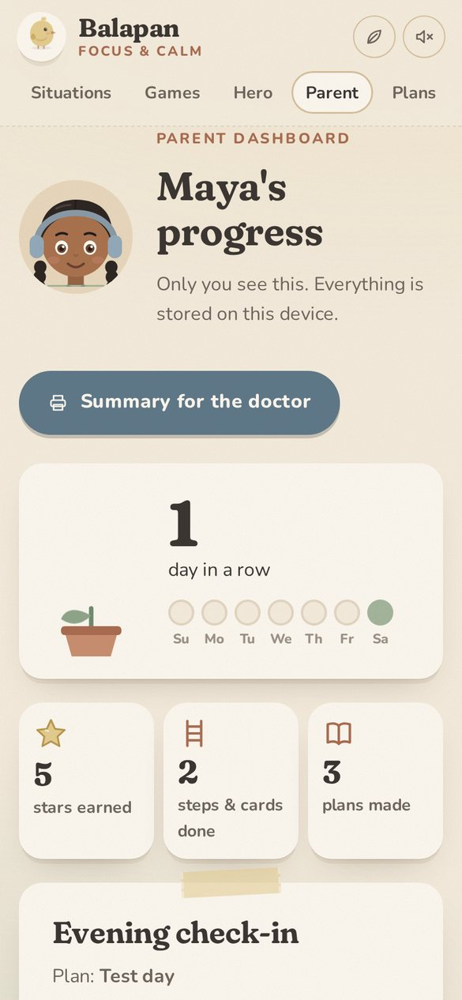
</p>

All screenshots are in [`docs/screenshots/`](docs/screenshots/).

---

## Run locally

No build step and no dependencies.

```bash
# Option 1: just open the file
open index.html            # macOS
xdg-open index.html        # Linux
start index.html           # Windows

# Option 2: any static server
npx serve .                # or: python3 -m http.server 8080
```

Everything works from `file://`. Data is embedded in JS files (no `fetch` of local JSON), and the scripts are classic scripts rather than ES modules, so there are no CORS issues.

## Deploy

- **Netlify:** drag the folder onto app.netlify.com/drop, or connect the repo. `netlify.toml` is included (publish dir `.`, no build command).
- **GitHub Pages:** Settings → Pages → Deploy from branch → `main` / root.
- **Vercel:** `vercel` → Framework preset "Other", no build command, output dir `.`.

Routing is hash-based (`#/library`, `#/game/trail`, …), so no rewrite rules are needed anywhere.

## Project structure

```
balapan-focus-calm/
├── index.html              # app shell, header, footer, script includes
├── css/
│   ├── base.css            # tokens (palette, type), paper grain, motion + calm mode
│   ├── components.css      # header, buttons, chips, avatar animation, toast
│   ├── screens.css         # every screen + responsive rules
│   ├── games.css           # game stages
│   └── print.css           # printable doctor summary
├── js/
│   ├── data/
│   │   ├── situations.js   # 32 situations (tag, why, phrases, 5 steps, minutes, warm-up game)
│   │   └── content.js      # quiz, interests/buddies, story templates, habits, movement breaks
│   ├── core/
│   │   ├── store.js        # localStorage state (key "balapan.v1")
│   │   ├── avatar.js       # layered SVG hero + chick mascot
│   │   ├── engine.js       # template engine + LLM stub  ← plug a model in here
│   │   ├── router.js       # hash router
│   │   ├── ui.js, icons.js, sound.js
│   ├── screens/            # landing, quiz, builder, plan, library, brave, quest, games, dashboard, pricing, safety
│   ├── games/              # trail, lace, dots, jars, backpack, balloon, bubbles, memory
│   └── app.js              # boot + Calm/Sound toggles
├── assets/favicon.svg
├── docs/screenshots/
├── netlify.toml · LICENSE · .gitignore
```

## Where to plug in the LLM

Plans are generated offline by a template engine (`js/core/engine.js → buildPlan()`). It fills in the child's name, pronouns, interest-based buddy and world, the situation event and the ladder steps.

`BF.engine.generateWithLLM(situation, child)` is a **clearly marked stub**. To use a real model:

1. Create a serverless function (for example `netlify/functions/story.js`) that holds your API key **server-side**. Never ship keys to the browser.
2. Set `BF.config.llmEndpoint = "/.netlify/functions/story"` (in `engine.js` or a small config script).
3. Return JSON `{ story: [7 strings], phrases: [3 strings] }`. The stub merges it into the plan, and the templates stay as the automatic fallback if the call fails.

The prompt skeleton (system rules: warm, non-clinical, child-as-hero, no medical claims) is already in the stub.

## Payments

`js/screens/pricing.js` has `BF.config.stripeMonthly` / `stripeYearly` placeholders. Swap in real **Stripe Payment Links** (test mode first). In the prototype, checkout is simulated and only unlocks unlimited plans on the current device.

## Ethics & disclaimer

- Balapan is a **parenting support tool, not therapy, and not a medical device**. It does not diagnose or treat any condition and makes no medical claims.
- Red flags (self-harm talk, weeks of not sleeping or eating, daily panic, school refusal, danger to self or others) lead to "talk to your pediatrician or a child mental-health professional", plus **988** (call/text, US), **911**, and Crisis Text Line (text HOME to 741741).
- Privacy: no accounts and no server. Everything is in `localStorage`, and "Reset demo data" in the footer wipes it.
- The UI shows no statistics. We didn't want to put unverified numbers in front of parents.

## Roadmap

- [ ] Real LLM story generation via a serverless function (with safety filters)
- [ ] Optional account + sync between parents' phones
- [ ] Spanish UI
- [ ] Printable / AR "brave cards" for the fridge
- [ ] Therapist share link (read-only progress view)
- [ ] A/B-tested onboarding funnel (quiz → plan → trial)
- [ ] More situations co-written with child psychologists

## Team

- _Name_ — role
- _Name_ — role

---

## Кратко по-русски

**Balapan Focus & Calm** — веб-сервис для родителей детей 5–10 лет с тревожностью, СДВГ или **сразу обоими** (это отдельный фильтр «Both»). Родитель проходит квиз из 7 шагов и собирает персонажа, похожего на ребёнка: цвет кожи, волосы, глаза, одежда, обувь, телосложение. После этого он получает:

- **библиотеку из 32 ситуаций** (12 тревожность, 10 СДВГ, 10 «оба»): почему это трудно, что сказать ребёнку и лестницу из 5 шагов;
- **Brave Plan**: сказку, где ребёнок — главный герой, с чтением вслух и лестницей смелых шагов со звёздами;
- **Routine Quest**: по одной карточке, большой визуальный таймер, кнопку «Done» и минуту движения;
- **8 мини-игр**, из них 4 на мелкую моторику: дорожка пальцем, шнуровка, точки по номерам, пуговицы по баночкам;
- **кабинет родителя**: серия дней, вечерний чек-ин («слишком трудно» делит шаг на мини-шаг) и печатную сводку для врача.

Цвета приглушённые, есть «Calm mode», звук по умолчанию выключен. Регистрация не нужна, все данные хранятся в браузере. Запуск: открыть `index.html`. Это не терапия и не медицинский сервис.

## License

[MIT](LICENSE)
